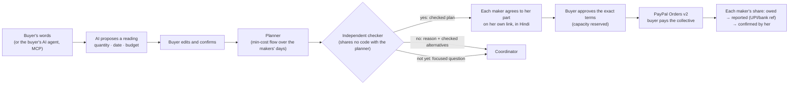

# Haat: bigger orders for small makers

Haat helps artisan collectives turn bulk requests into checked work plans, get each maker's
agreement on her part, collect one buyer payment through PayPal, and track each maker's
share until she confirms receipt.

**AI assists. Code checks. Makers decide. Buyers pay with PayPal.**

> Built for the [PayPal AI Hackathon 2026](https://paypalaihackathon.devpost.com/). Direction and claim boundaries: [docs/direction.md](docs/direction.md).

## Who it is for

Existing artisan collectives in India that make a standard product for overseas boutiques and
gifting buyers, with a coordinator who already manages the work. The demo is three block
printers in Bagru who share one finishing table and make hand block-printed cotton scarves.

A home-based maker can make a few pieces a week. When a buyer asks for 30 or 300 by a date,
the coordinator has to reconcile several makers' availability, materials, prices and other
promises. Haat gives the group a shared, checked plan, and gives each maker a clear record
of her own work and pay.

## How an order moves



1. **The request.** The buyer describes the order on `/c/request`, or the buyer's agent calls
   the MCP tool `request_collective_order`.
   - AI proposes values for four fields only: quantity, date, budget and a description.
   - Code checks each value against the buyer's words. A number not found there, or a date
     the words don't state explicitly, is marked "please check". A missing value stays
     empty, with a question.
   - Only what the buyer confirms becomes the order.
2. **The plan.** Haat plans the order across the makers' recorded days, materials dates,
   other promises, caps and asking prices, plus the shared finishing table. Each answer
   goes through the independent checker before anyone sees it. There are three answers:
   - **Yes**, with the cheapest plan. "Cheapest" is certified when every maker's facts are
     complete.
   - **No**, with the reason (a capacity cut or a certified minimum price) and checked
     alternatives: the most pieces by the date, the earliest date for all of them, or the
     most pieces within the budget.
   - **Not decided yet**, with what's missing. If one unknown materials date is all that
     blocks the answer, the coordinator gets the date that decides it, checked at both
     ends.
3. **Alone or together.** The coordinator sees what each maker could do alone. When no maker
   could do it alone and the group can, both answers checked, the buyer sees exactly one
   sentence: "No individual maker can fulfil this request within its date and budget. The
   collective can." There are no names or figures in it.
4. **Her part.** Each maker sees only her own part (pieces per day, pay, dispatch date) on
   her personal link. The terms are read back in Hindi and hashed. If a plan changes, the
   coordinator can send one that keeps the agreed parts identical; only makers whose part
   changed are asked again.
5. **Payment.** The buyer approves the exact terms. Capacity is re-checked and reserved in
   the same transaction. The buyer then pays the collective, which is the seller, through
   PayPal. Haat records PayPal's own capture, fee and net.
6. **Her share.** The coordinator pays each maker outside Haat (UPI or bank) and records the
   reference. The payment counts as received only when she confirms it on her link.

## What we have shown, and what we haven't

**Comparative evaluation:** 46 synthetic cases (6 hand-written, 40 generated from seed
`20261108`). Every answer was judged by the same independent checker. Details are in
[docs/evaluation.md](docs/evaluation.md) and
[eval/results/seed-20261108.md](eval/results/seed-20261108.md).

| | Planner (M1) | Rule-based split | Old Haat (one maker) |
|---|---|---|---|
| Decision correct | 46/46 | 44/46 | 29/38 (8 unsupported) |
| Complete answer correct (price and maximum included) | 46/46 | 43/46 | 13/38 |
| Unsafe promises | 0 | 0 | 8 |

- On these cases, the planner and a careful rule-based split both made **no unsafe
  promises**. The planner found one feasible order the rule missed, and differed once on
  how to classify incomplete facts.
- The planner's own column is a consistency check against its checked model, not
  independent evidence.
- The old single-maker rule's 8 unsafe promises show why it was replaced. They don't show
  that coordinators make those mistakes.
- The AI-deciding-directly baseline runs separately.

**One complete sandbox transaction:**
- A 30-scarf order for $236.86, made by two makers.
- PayPal capture `6XH61035R53768108`, COMPLETED. PayPal's actual fee was $11.26 against an
  estimate of $10.72.
- One maker's ₹4,200 share was reported with a test UPI reference and confirmed on her link.

This proves the integration works end to end. The payout was not a real bank transfer, and
the maker was played by the project owner. It does not show an artisan earning income.

**Not yet established:** real use by a collective, extra orders won, or whether makers can
keep their facts current without help. The [role-play kit](docs/role-play-kit.md) measures
the last one with people. It is labelled a role-play, not a pilot.

**What "checked" means:** a plan is consistent with the facts recorded for the makers. It
cannot show those facts are true, that every piece will match, or that a courier will be on
time. A personal link proves possession of the link, not identity.

## Quick start

Requirements: **Node.js 20+**. No database to install: an embedded Postgres runs automatically.

```bash
git clone <this repo> haat && cd haat
npm install
cp .env.example .env.local   # then fill in the keys (see below)
npm run smoke                # checks PayPal sandbox + AI + DB connectivity
npm run dev                  # http://localhost:3000
```

- **Buyer:** `/c/request` makes a bulk request. `/c/orders/{id}` shows the terms, approval
  and PayPal payment.
- **Coordinator:** `/seller/collective`, after entering `SELLER_PASSCODE`. It covers
  makers' facts, plans, the alone-or-together check, sending parts, payouts, and personal
  links.
- **Maker:** `/m/{token}`, her personal link, shown once to the coordinator. It covers her
  facts, her parts, and confirming each payment.

### Keys you need

| Variable | Where to get it |
|---|---|
| `PAYPAL_CLIENT_ID`, `PAYPAL_CLIENT_SECRET` | [developer.paypal.com](https://developer.paypal.com/dashboard/applications/sandbox) → Apps & Credentials → **Sandbox** → Create App (Merchant) |
| `GOOGLE_API_KEY` | Free at [aistudio.google.com](https://aistudio.google.com/apikey). Alternatively set `AI_PROVIDER=openai` and `OPENAI_API_KEY`. Without a working key, buyers fill in the request form themselves. |
| `SELLER_PASSCODE` | Any 4–12 digit PIN. Unlocks the studio (`/seller`). |
| `CHANNEL3_API_KEY` *(optional)* | Only for the single-maker shop's fair-price coach. |

Everything runs against the **PayPal sandbox**. No real money moves.

| Command | What it does |
|---|---|
| `npm test` | The full test suite, on embedded PGlite (or PostgreSQL with `DATABASE_URL=…`) |
| `npm run eval` | The comparative evaluation (deterministic; the AI baseline uses the Gemini quota and is cached per case) |
| `npm run smoke` | Live connectivity check: PayPal, Gemini, Agent Toolkit |
| `npm run demo:reset` | Clear test orders and requests (backs up the local database first; stop `npm run dev` before running) |
| `npm run db:migrate` | Apply migrations (runs automatically in the Vercel build) |

**Deploying:** free on Vercel + Neon. See [DEPLOY.md](DEPLOY.md).

## Agents (MCP)

`/api/mcp` is a remote MCP server (Streamable HTTP). For collective orders:

| Tool | What it does |
|---|---|
| `request_collective_order` | Sends the requirements the user confirmed (quantity, delivery date, optional budget and details). Returns today's checked first answer and the link where the **human** sees the terms, approves and pays |
| `get_collective_order` | Status and terms, in aggregate only: no maker's name, availability or pay |

Agents cannot approve terms or pay. The single-maker shop's tools (search, checkout,
messages, custom orders) are listed in [docs/single-maker.md](docs/single-maker.md).

## How PayPal and AI are used

| Step | PayPal | AI | Code that decides |
|---|---|---|---|
| Request | none | Reads the buyer's words into a proposal (Gemini, temperature 0) | Grounding against the words; only buyer-confirmed fields become the order |
| Plan | none | none | Min-cost flow planner; independent checker; certificates for every refusal and alternative |
| Payment | Orders v2: the collective is the seller; capture lease; webhooks; PayPal's own fee and net recorded | none | One capture per plan, bound to the approved terms' hash |
| Maker payouts | none (paid outside PayPal by UPI or bank) | none | Owed → reported with reference → confirmed by her link |

AI is kept out of anything that sets a quantity, date or price for the makers. The
evaluation includes an AI model deciding directly, to show why.

## Contracts

- [docs/direction.md](docs/direction.md): direction, sections A–D, and the claims we make and don't.
- [docs/planner-model.md](docs/planner-model.md): model M1, certificates, extension M1-Q1 (one unknown materials date).
- [docs/collective-consent.md](docs/collective-consent.md): consent, reservations, payment, payouts, requests, keeping agreed parts.
- [docs/evaluation.md](docs/evaluation.md) and [docs/role-play-kit.md](docs/role-play-kit.md).

## Also built

Haat began as a voice-first back office for a single maker: listings from a photo, Scam Shield, custom orders
held to her stated costs, Maker Evidence and a Hindi assistant. It is still in the app and
tested. It is described in [docs/single-maker.md](docs/single-maker.md).

## Scope of this version

- **Product.** One product family per order, with interchangeable pieces and one shared
  finishing stage. Mixed products are out of scope.
- **Buyers.** Payments are through PayPal, for overseas buyers. Domestic Indian buyers
  would need another payment route.
- **Payouts.** Maker payouts happen outside Haat. Haat records them and the maker confirms;
  it doesn't move the money.
- **No pilot yet.** The role-play kit measures whether people can keep facts current and
  understand their part.
- **No notifications.** No email or SMS. Buyers and makers open their links.

## AI tools used

- **Google Gemini** (via the Vercel AI SDK): buyer request reading; in the single-maker shop, listings, translation and voice.
- **PayPal Agent Toolkit** (`@paypal/agent-toolkit`): single-maker back office.
- **Claude Code**: coding assistant during development.

## License

[MIT](LICENSE)
